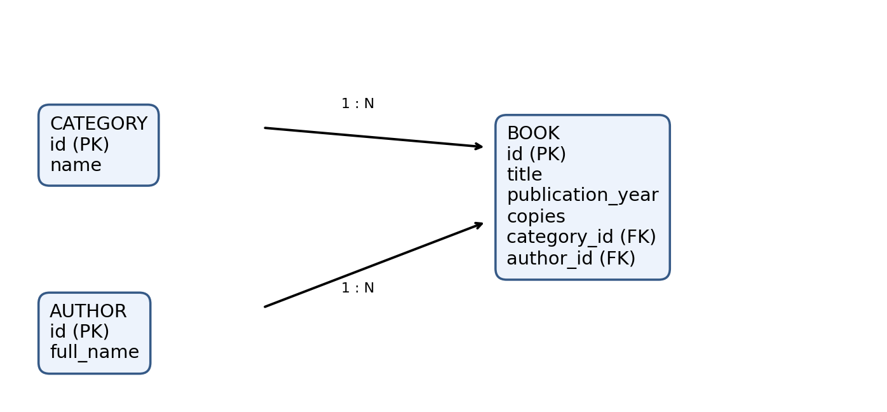

# Университеттің электрондық кітапханасы

**Пән:** Прикладное программное обеспечение информационных систем (2026)

Бұл жоба университет кітапханасындағы кітаптар туралы мәліметтерді басқаруға арналған.
Кітаптарды қосу, қарау, іздеу, өзгерту және өшіру мүмкіндігі бар.

## Орындалған лабораториялар
- №1: тақырып, жоба құрылымы, ER-диаграмма, Git үшін конфигурация.
- №2: SQLModel, SQLite, 3 байланысты кесте және seed.py.
- №3: FastAPI, GET және POST, Swagger UI.
- №4: PATCH, DELETE, GET сүзгілері, 404/422 тексерулері.
- №5: Streamlit веб-интерфейсі (кітаптарды көрсету, іздеу, қосу, өзгерту, жою).
- №6: Docker Compose арқылы екі сервисті іске қосу және SQLite volume.
- №7: pytest/TestClient интеграциялық тесттері, финалдық құжаттама.

## ER-диаграмма


**Кестелер:** Category (1) → (N) Book; Author (1) → (N) Book.

## Технологиялар
Python, FastAPI, SQLModel, SQLite, Uvicorn; кейін Streamlit және Docker.

## Windows PowerShell-де іске қосу
```powershell
python -m venv venv
.\venv\Scripts\python.exe -m pip install -r requirements.txt
.\venv\Scripts\python.exe seed.py
.\venv\Scripts\python.exe -m uvicorn app.main:app --reload
```
Браузерде **http://127.0.0.1:8000/docs** ашыңыз.
Егер PowerShell виртуалды ортаны белсендіруге рұқсат бермесе де, жоғарыдағы командалар жұмыс істейді.

## Swagger арқылы тексеру (№4)
1. `GET /books?search=Python` — атау бойынша іздеу.
2. `GET /books?min_year=2010&max_year=2025` — жыл бойынша сүзгі.
3. `PATCH /books/1` денесі: `{"copies": 10}` — тек дана санын өзгертеді.
4. `GET /books/1` — жаңа санды тексеру.
5. `POST /books` денесі: `{"title":"Test Book","publication_year":2022,"copies":2,"category_id":1,"author_id":1}` — жаңа кітап қосу; жауаптан оның id мәнін қараңыз.
6. `DELETE /books/{id}` — тек жаңадан қосылған тест кітабын өшіру; жауап 204.
7. Сол id үшін `PATCH` жіберсеңіз — 404. Теріс `copies` жіберсеңіз — 422.

## GitHub
Жергілікті папка Git репозиторийі емес. Өз репозиторийіңізге көшірген соң:
```powershell
git add .
git commit -m "feat: implement library CRUD labs 1-4"
git push origin main
```
GitHub-қа жүктеу қолмен жасалады; `database.db` және `venv` Git-ке кірмейді.

## №5: веб-интерфейсті іске қосу
Бір терминалда API сервері жұмыс істеп тұрсын. Екінші терминалда:
```powershell
.\venv\Scripts\python.exe -m streamlit run app/frontend/ui.py
```
Браузер: http://localhost:8501

## №6: Docker арқылы іске қосу
Docker Desktop орнатылған және қосулы болуы тиіс:
```powershell
docker compose up --build
```
Браузер: http://localhost:8501, Swagger: http://localhost:8000/docs. Деректер `library_data` Docker volume ішінде сақталады. `docker compose down -v` деректерді өшіреді.

## №7: автоматты тесттер
```powershell
.\venv\Scripts\python.exe -m pytest -v
```
Тесттер бөлек уақытша SQLite базасында орындалады.

## GitHub-қа алғаш рет жүктеу
GitHub сайтында бос public `university-library-is` репозиторийін құрыңыз (README/.gitignore автоматты қоспаңыз). Содан кейін жоба папкасында:
```powershell
git init
git branch -M main
git add .
git commit -m "feat: complete university library labs 1-7"
git remote add origin https://github.com/YOUR_USERNAME/university-library-is.git
git push -u origin main
```
`YOUR_USERNAME` орнына GitHub логиніңізді жазыңыз. `git remote -v`, `git status` командаларымен тексеріңіз. `venv/` және `database.db` GitHub-қа жүктелмейді.

## Есептер
- [№1–4 есеп](docs/LAB_1_4_REPORT.md)
- [№5–7 есеп](docs/LABS_5_7_REPORT.md)
